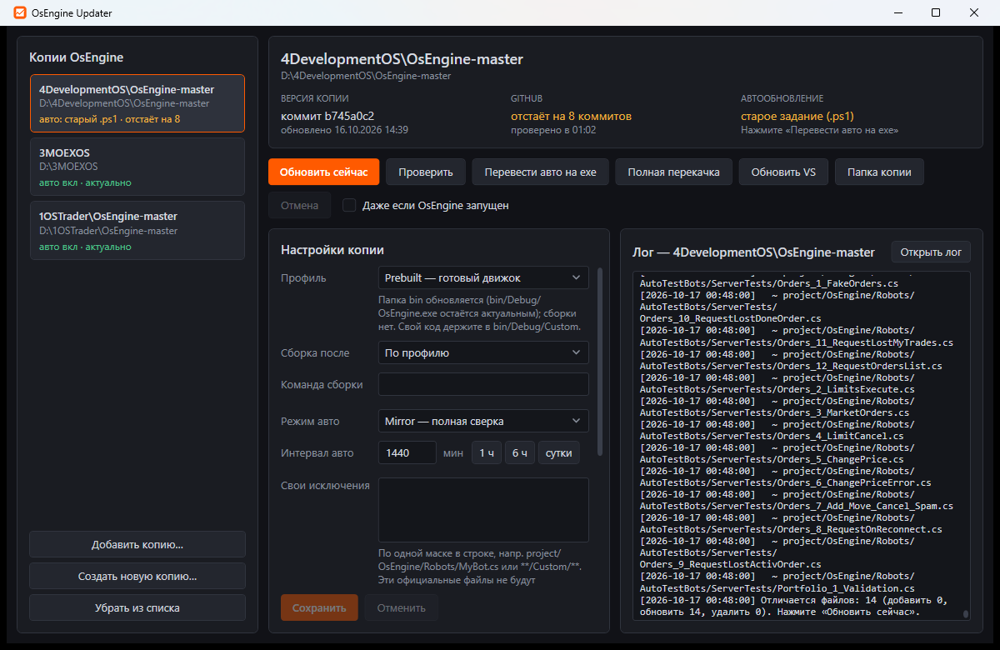

# OsEngine Updater

Утилита для обновления локальных копий **[OsEngine](https://github.com/AlexWan/OsEngine)** прямо из официального репозитория — с окном для настроек, автообновлением и логом.

Принцип: **обновляются только официальные файлы**. Всё, чего нет в репозитории (ваши роботы, индикаторы, папки), не трогается никогда. Список своих папок вести не нужно.



---

## Запуск

`OsEngineUpdater.exe` — один файл, .NET устанавливать не нужно. Двойной клик открывает окно:

- **слева** — все ваши копии OsEngine. Утилита сама находит копию, в которой лежит, и копии, для которых уже включено автообновление. Остальные добавьте через «Добавить копию…»;
- **сверху** — состояние копии: какой коммит применён, на сколько коммитов она отстаёт от GitHub, когда было и будет автообновление;
- **кнопки**:

| Кнопка | Что делает |
|---|---|
| **Обновить сейчас** | Полная сверка с репозиторием (Mirror): добавить, обновить и удалить официальные файлы. |
| Проверить | Показать, что изменится, ничего не меняя. |
| Включить / Выключить авто | Задание в Планировщике Windows: при входе в систему и каждые N минут. |
| Полная перекачка | Скачать архив репозитория (~200 МБ) и перезаписать все официальные файлы. |
| Обновить VS | Заставить Visual Studio показать файлы, добавленные в `Robots`/`Indicators`. |
| Создать новую копию… | Скачать свежую копию OsEngine в пустую папку. |

- **Настройки копии** — редактируются в окне и сохраняются кнопкой «Сохранить». Если автообновление включено, задание в Планировщике сразу перенастраивается на новый интервал и режим.
- **Лог** — живой вывод операции и история из `update.log`.

Пока OsEngine этой копии запущен, обновление пропускается (файлы `bin` заняты). Чтобы обновить всё равно, отметьте «Даже если OsEngine запущен».

> Задание автообновления запускает тот `OsEngineUpdater.exe`, из которого его включили. Если вы переместили exe, включите авто заново.

---

## Профиль — главная настройка

| Profile | Для кого | Что с `bin` | Сборка |
|---|---|---|---|
| **`Prebuilt`** | Вы используете готовый движок (`bin/Debug/OsEngine.exe`), а свой код кладёте в `bin/Debug/Custom/...` | **Обновляется** (движок остаётся актуальным) | не запускается |
| **`FromSource`** | Вы собираете решение сами, и кастомный код компилируется в движок | **Защищена** (ваша сборка не затирается) | запускается после обновления |

> Если вы собираете своих роботов или индикаторы **в движок** (например, в VS), выбирайте `FromSource`. Иначе `Prebuilt` обновит `bin/Debug/OsEngine.dll` официальной версией.

---

## Настройки

Хранятся отдельно для каждой копии в `<копия>\.osengine-updater\config.json`. Старый `UpdateOsEngine.config.json` переносится туда автоматически.

| Поле в окне | В файле | Назначение |
|---|---|---|
| Профиль | `Profile` | `Prebuilt` или `FromSource`. |
| Сборка после | `BuildAfterUpdate` | По профилю (`null`) / всегда (`true`) / никогда (`false`). |
| Команда сборки | `BuildCommand` | Пусто — `dotnet build "project\OsEngine\OsEngine.csproj" -c Debug`. |
| Режим авто | `AutoMode` | `Mirror` (полная сверка, сама чинит пропавшие файлы) или `Delta` (только изменения между коммитами). |
| Интервал авто | `AutoIntervalMinutes` | В минутах (1440 = раз в сутки). |
| Свои исключения | `UserProtectedPaths` | Маски официальных файлов, которые не надо перезаписывать (`*`, `**`, `?`). |
| Owner / Repo / Branch | `Owner`, `Repo`, `Branch` | Источник на GitHub. |
| Токен | `GitHubToken` | Необязательно. Без токена — 60 запросов к API в час на компьютер. |

Служебные файлы каждой копии: `<копия>\.osengine-updater\{config.json, state.json, official-manifest.txt, update.log}`.
Список копий в окне: `%LOCALAPPDATA%\OsEngineUpdater\copies.json`.

---

## Как это работает

- **Правило «только официальные файлы».** Утилита получает дерево файлов репозитория и меняет только те пути, которые в нём есть.
- **Mirror.** Считает git-blob-SHA локальных файлов, сверяет их с деревом GitHub и качает только отличия (в 8 потоков). Удаляет только те официальные файлы, которые исчезли из репозитория.
- **Delta.** Применяет список изменений между прошлым и новым коммитом. Если изменений слишком много, автоматически переходит на Mirror.
- **Кнопка «Обновить (N)» в OsEngine.** После обновления утилита записывает дату применённого коммита в `Engine\Updater\LastUpdatesInfo.txt`, поэтому встроенный счётчик OsEngine не показывает уже применённые изменения.
- **Защищено всегда:** `**/obj/**`, `**/.vs/**`, `**/.git/**`, `**/*.user`; при `FromSource` ещё и `**/bin/**`.

---

## Командная строка

Нужна для Планировщика, но может пригодиться и вручную:

```
OsEngineUpdater.exe --update <копия> [--mode mirror|delta|full|check] [--silent] [--force] [--no-build]
OsEngineUpdater.exe --auto-on <копия>
OsEngineUpdater.exe --auto-off <копия>
OsEngineUpdater.exe --status <копия>
OsEngineUpdater.exe --new-copy <папка>
```

Коды выхода: `0` — успешно, `1` — ошибка, `2` — пропущено (OsEngine запущен), `3` — уже выполняется, `4` — отменено.

---

## Переход со старой версии (.cmd / .ps1)

1. Откройте `OsEngineUpdater.exe` — копии со старым автообновлением отмечены как «старое задание (.ps1)».
2. Нажмите **«Перевести авто на exe»**.
   Если старое задание создавали от имени администратора, Windows не даст его изменить. Тогда **один раз** запустите `OsEngineUpdater.exe` от имени администратора и нажмите кнопку снова. Новое задание работает без прав администратора.
3. После этого `UpdateOsEngine.ps1` и `UpdateOsEngine.config.json` можно удалить.

---

## Сборка из исходников

```
dotnet publish src/OsEngineUpdater -c Release -o publish
```

Получится `publish\OsEngineUpdater.exe` (single-file, self-contained, win-x64). Нужен .NET SDK 10.

---

## Ограничения

- **Ваши правки официальных файлов** перезаписываются при обновлении. Вынесите их в «Свои исключения» или в `bin/Custom`.
- **Git-подмодуль** `related projects/FinamApi/finam-trade-api` не зеркалится.
- **Новая копия и полная перекачка** скачивают архив целиком (~200 МБ). Для ежедневного обновления используйте «Обновить сейчас».

---

## Автор

SidorenkoVA — [@si0683](https://github.com/si0683)

Основано на проекте [AlexWan/OsEngine](https://github.com/AlexWan/OsEngine).
