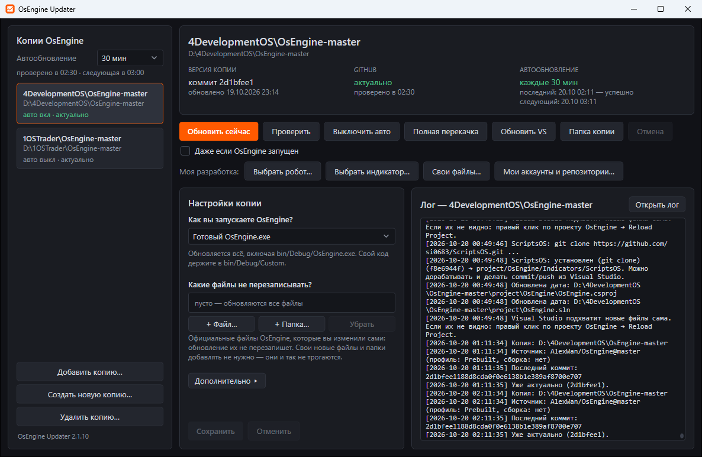

# OsEngine Updater

Обновляет ваши копии [OsEngine](https://github.com/AlexWan/OsEngine) из официального репозитория — в один клик или автоматически.

Меняются **только официальные файлы**. Ваши роботы, индикаторы и папки не трогаются.

## ⬇ [Скачать OsEngineUpdater.exe](https://github.com/si0683/OsEngineUpdater/releases/latest/download/OsEngineUpdater.exe)

1. Скачайте файл и положите его в свою папку, например `D:\Tools\OsEngineUpdater`.
2. Запустите двойным щелчком. Если Windows скажет «Windows защитила ваш компьютер» — «Подробнее» → «Выполнить в любом случае».
3. Дальше программа обновляется сама.

> Скачали архив кнопкой **Code → Download ZIP**? В нём исходники, а не программа. Распакуйте и запустите `Запустить OsEngineUpdater.cmd` — он скачает программу сам.

## Как пользоваться

- **Слева** — ваши копии OsEngine. Нет нужной — «Добавить копию…» или «Создать новую копию…».
- **Обновить сейчас** — обновить выбранную копию.
- **Включить авто** — копия будет обновляться сама, даже когда окно закрыто. Как часто — выбирается слева вверху.
- **Как вы запускаете OsEngine?** — «Готовый OsEngine.exe» (обычно) или «Собираю сам в Visual Studio». Определяется автоматически.
- **Какие файлы не перезаписывать?** — официальные файлы, которые вы изменили сами.

## Свои роботы и индикаторы

1. «Мои аккаунты и репозитории…» → впишите логин GitHub и/или GitFlic.
2. «Выбрать робот…» или «Выбрать индикатор…» → отметьте нужное → «Установить / обновить отмеченные».

Робот, поставленный целиком, — это git-репозиторий: его можно дорабатывать и делать commit / push из Visual Studio.

Токен нужен для закрытых репозиториев GitHub и для аккаунта GitFlic. Как его получить — ссылка «Как получить токен?» прямо в окне.

## Вопросы

**Антивирус ругается на exe.** Программа не подписана цифровой подписью, это ложное срабатывание. Проверить файл можно по контрольной сумме из [релиза](https://github.com/si0683/OsEngineUpdater/releases/latest): `certutil -hashfile OsEngineUpdater.exe SHA256`.

**В логе «Нет прав на изменение задания… создано от имени администратора».** Один раз запустите программу от имени администратора и нажмите «Выключить авто», затем «Включить авто».

**Ошибка «Исчерпан лимит GitHub API».** Укажите токен GitHub: «Настройки копии» → «Дополнительно» → «Токен GitHub».

---

Подробное описание всех кнопок, настроек, командной строки и сборки — в [docs/DETAILS.md](docs/DETAILS.md).

Автор: SidorenkoVA — [@si0683](https://github.com/si0683). Основано на [AlexWan/OsEngine](https://github.com/AlexWan/OsEngine).
