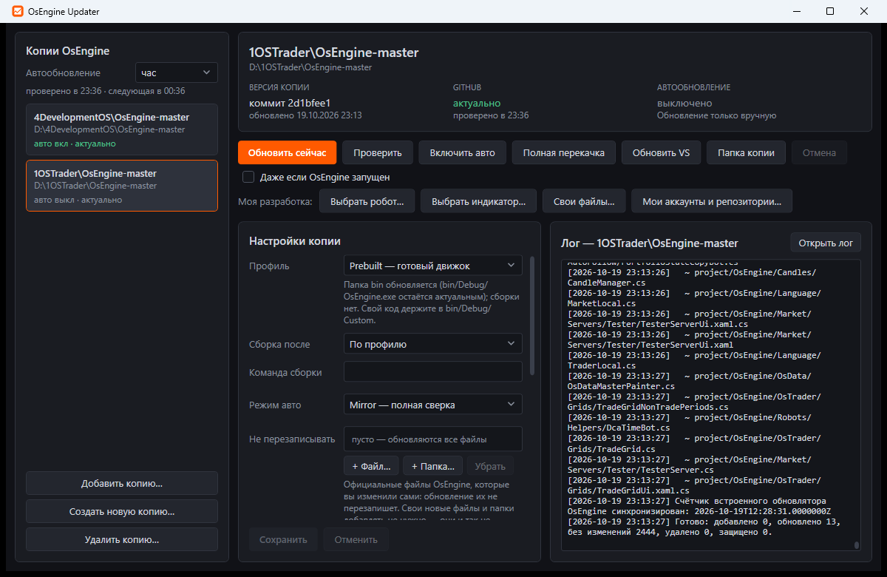

# OsEngine Updater

Утилита для обновления локальных копий **[OsEngine](https://github.com/AlexWan/OsEngine)** прямо из официального репозитория — с окном для настроек, автообновлением и логом.

Принцип: **обновляются только официальные файлы**. Всё, чего нет в репозитории (ваши роботы, индикаторы, папки), не трогается никогда. Список своих папок вести не нужно.



---

## Запуск

**Скачать:** последний `OsEngineUpdater.exe` в [релизах](https://github.com/si0683/OsEngineUpdater/releases/latest). Положите его в свою папку, например `D:\Tools\OsEngineUpdater`; дальше программа обновляется сама.

`OsEngineUpdater.exe` — один файл, .NET устанавливать не нужно. Двойной клик открывает окно:

- **слева** — все ваши копии OsEngine. Утилита сама находит копию, в которой лежит, и копии, для которых уже включено автообновление. Остальные добавьте через «Добавить копию…»;
- **сверху** — состояние копии: какой коммит применён, на сколько коммитов она отстаёт от GitHub, когда было и будет автообновление;
- **кнопки**:

| Кнопка | Что делает |
|---|---|
| **Обновить сейчас** | Полная сверка с репозиторием (Mirror): добавить, обновить и удалить официальные файлы. |
| Проверить | Показать, что изменится, ничего не меняя. |
| Включить / Выключить авто | Автообновление этой копии: окно обновляет её само, а когда окно закрыто, работает задание Планировщика Windows (при входе в систему и с общей частотой). |
| Полная перекачка | Скачать архив репозитория (~200 МБ) и перезаписать все официальные файлы. |
| Обновить VS | Заставить Visual Studio показать файлы, добавленные в `Robots`/`Indicators`. |
| Создать новую копию… | Скачать свежую копию OsEngine в пустую папку. |
| Удалить копию… | Отправить всю папку копии в Корзину и выключить её автообновление. Нужно ввести имя папки для подтверждения. Программа сама закроет всё, что держит файлы копии: OsEngine, Visual Studio, процессы сборки, git (список видно заранее; несохранённые изменения в них пропадут). Системные программы — Проводник, антивирус — не закрываются. Удаление запрещено, только если из копии запущена сама утилита или автообновление других копий использует exe из неё. |

- **Настройки копии** — редактируются в окне и сохраняются кнопкой «Сохранить». Если автообновление включено, задание в Планировщике сразу перенастраивается на новый режим.
- **Лог** — живой вывод операции и история из `update.log`.
- **Ширина панелей.** Границы между списком копий и правой частью и между настройками и логом можно тянуть мышью. Ширины запоминаются, двойной щелчок по границе возвращает исходную ширину.
- **Автообновление — одна частота на все копии.** Она выбирается под заголовком «Копии OsEngine»: 10 мин, 30 мин, час, 6 часов или сутки. Пока окно открыто, оно с этой частотой проверяет GitHub и сразу обновляет копии с включённым авто. Об остальных копиях в логе появляется сообщение, в заголовке окна — число отстающих копий («есть обновления (N)»), а кнопка на панели задач мигает, если окно не активно. На эту же частоту перенастраиваются задания Планировщика, которые работают, когда окно закрыто. Копии с одинаковым источником проверяются одним запросом, а автозапуск без нового коммита стоит один запрос к GitHub, поэтому лимит API почти не тратится.
- **Изменения копий видны сразу.** Окно следит за служебными файлами копий. Если копию обновило автообновление из Планировщика или запуск из командной строки, версия, отставание и лог в окне обновятся без нажатий.

Пока OsEngine этой копии запущен, обновление пропускается (файлы `bin` заняты). Чтобы обновить всё равно, отметьте «Даже если OsEngine запущен».

> Задание автообновления запускает тот `OsEngineUpdater.exe`, из которого его включили. Если вы переместили exe, включите авто заново.

---

## Профиль — главная настройка

| Profile | Для кого | Что с `bin` | Сборка |
|---|---|---|---|
| **`Prebuilt`** | Вы используете готовый движок (`bin/Debug/OsEngine.exe`), а свой код кладёте в `bin/Debug/Custom/...` | **Обновляется** (движок остаётся актуальным) | не запускается |
| **`FromSource`** | Вы собираете решение сами, и кастомный код компилируется в движок | **Защищена** (ваша сборка не затирается) | запускается после обновления |

> Если вы собираете своих роботов или индикаторы **в движок** (например, в VS), выбирайте `FromSource`. Иначе `Prebuilt` обновит `bin/Debug/OsEngine.dll` официальной версией.

---

## Настройки

Хранятся отдельно для каждой копии в `<копия>\.osengine-updater\config.json`. Старый `UpdateOsEngine.config.json` переносится туда автоматически.

| Поле в окне | В файле | Назначение |
|---|---|---|
| Профиль | `Profile` | `Prebuilt` или `FromSource`. |
| Сборка после | `BuildAfterUpdate` | По профилю (`null`) / всегда (`true`) / никогда (`false`). |
| Команда сборки | `BuildCommand` | Пусто — `dotnet build "project\OsEngine\OsEngine.csproj" -c Debug`. |
| Режим авто | `AutoMode` | `Mirror` (полная сверка, сама чинит пропавшие файлы) или `Delta` (только изменения между коммитами). |
| Не перезаписывать | `UserProtectedPaths` | Официальные файлы OsEngine, которые вы изменили сами: кнопки «+ Файл…» и «+ Папка…» открывают обычное окно выбора, путь утилита составит сама (папка — всё внутри неё). Свои новые файлы добавлять не нужно: их обновление и так не трогает. Убрать — выделить и нажать «Убрать» или Delete. |
| Owner / Repo / Branch | `Owner`, `Repo`, `Branch` | Источник на GitHub. |
| Токен | `GitHubTokenProtected` | Необязательно. Без токена — 60 запросов к API в час на компьютер, с токеном — 5000; с ним же обновляется и закрытый форк. Хранится зашифрованным для вашей учётной записи Windows (DPAPI); открытый `GitHubToken` из старых конфигов шифруется автоматически. |
| Папка роботов | `RobotsDir` | Куда ставить своих роботов. По умолчанию `project\OsEngine\Robots`. |
| Папка индикаторов | `IndicatorsDir` | Куда ставить свои индикаторы. По умолчанию `project\OsEngine\Indicators`. |
| (окно «Свои файлы») | `FilesDir` | Куда ставить свои файлы. По умолчанию `project\OsEngine`. |

Служебные файлы каждой копии: `<копия>\.osengine-updater\{config.json, state.json, official-manifest.txt, packages.json, update.log}`.
Общие для программы: `%LOCALAPPDATA%\OsEngineUpdater\copies.json` (список копий) и `settings.json` («Мои аккаунты и репозитории»).

---

## Моя разработка: пакетный менеджер своих роботов, индикаторов и файлов

Свои роботы, индикаторы и доработки хранятся в ваших репозиториях GitHub или GitFlic и ставятся в любую копию в пару кликов: целиком или отдельными файлами.

**1. «Мои аккаунты и репозитории…»** — общий для всех копий список. Вставьте адрес:

| Что указать | Пример | Что будет в окне выбора |
|---|---|---|
| Аккаунт GitHub | `https://github.com/si0683` | все репозитории аккаунта |
| Аккаунт GitFlic | `https://gitflic.ru/user/si0683` | все проекты аккаунта |
| Один репозиторий | `https://github.com/si0683/TemplateRobotScreenerSL` | только он (можно указать ветку) |

**Токен** (поле в той же записи):
- GitHub — необязателен. Нужен, чтобы видеть и ставить **закрытые** репозитории.
- GitFlic — **обязателен для аккаунта**: без токена GitFlic не отдаёт список проектов.
- Токен хранится зашифрованным для вашей учётной записи Windows (DPAPI) и передаётся git через переменные окружения, а не в командной строке.

Кнопка «Проверить» сразу показывает, сколько репозиториев видно (и сколько из них закрытых). Ссылка **«Как получить токен?»** под полем открывает эту же инструкцию и кнопку, которая ведёт на страницу создания токена.

#### Где взять токен GitHub

1. Откройте [github.com/settings/personal-access-tokens/new](https://github.com/settings/personal-access-tokens/new) и войдите в свой аккаунт.
2. **Token name** — например `OsEngineUpdater`. **Expiration** — 90 дней или год.
3. **Repository access** — *All repositories* (или *Only select repositories* — тогда утилита увидит только выбранные).
4. **Permissions → Repository permissions → Contents: Read-only**. *Metadata: Read-only* выставится сам, остальное не трогайте.
5. **Generate token**: скопируйте токен (начинается с `github_pat_`) и вставьте в поле «Токен» → «Проверить» → «Сохранить».

Такой токен может только читать. Классический токен ([github.com/settings/tokens/new](https://github.com/settings/tokens/new?description=OsEngineUpdater&scopes=repo)) тоже подойдёт, нужна одна галочка `repo`, но он даёт ещё и право записи.

#### Где взять токен GitFlic

1. Войдите на [gitflic.ru](https://gitflic.ru) и откройте свой профиль.
2. Раздел **«API токены»** → **«Создать»**.
3. Название — например `OsEngineUpdater`, срок действия — по желанию.
4. Права: **`PROJECT_READ`** (список проектов) и **`REPOSITORY_READ`** (скачивание файлов). Других прав не нужно.
5. Нажмите «Создать», скопируйте токен и вставьте в поле «Токен» → «Проверить» → «Сохранить».

Токен показывается один раз. Если потеряли, создайте новый.

> Этот же токен GitHub можно вставить в **настройки копии → Токен**. Тогда при обновлении OsEngine не будет ошибки «Исчерпан лимит GitHub API»: с токеном лимит 5000 запросов в час вместо 60.

**2. «Выбрать робот…» / «Выбрать индикатор…» / «Свои файлы…»** — тип установки выбирается кнопкой. Открывается окно:

- **слева** — репозитории всех ваших аккаунтов с поиском и статусом: не установлен, установлен (коммит, дата, целиком или сколько файлов) или есть обновление;
- **справа** — дерево файлов выбранного репозитория с галочками. Галочка на папке отмечает всё внутри. Кнопки «Все» и «Ничего»;
- отметьте один или несколько репозиториев (отметка файлов отмечает и репозиторий) и нажмите **«Установить / обновить отмеченные»**.

| Кнопка | Куда ставится |
|---|---|
| Выбрать робот… | `<папка роботов копии>\<имя репозитория>\…` |
| Выбрать индикатор… | `<папка индикаторов копии>\<имя репозитория>\…` |
| Свои файлы… | в папку, указанную в окне (по умолчанию `project\OsEngine`), со структурой репозитория. Так можно подменить стандартные файлы OsEngine своими версиями |

**Целиком = рабочий git-репозиторий.** Робот или индикатор, поставленный целиком (отмечены все файлы), становится полноценным клоном: в папке есть `.git`, `.gitignore`, `.gitattributes` и связь с GitHub / GitFlic. Его можно дорабатывать прямо в копии и делать commit / push из Visual Studio.
- «Установить / обновить» для такой папки выполняет `git pull`. Ваши незакоммиченные правки не затираются. Если ваши коммиты расходятся с сервером, утилита сообщит об этом, и обновлять придётся в Visual Studio (Git → Pull).
- Если папка уже была поставлена файлами, без `.git`, при установке целиком она превращается в клон на месте. Недостающие файлы докачиваются, а ваши отличия от репозитория видны в Visual Studio как изменения.
- При удалении такой папки утилита предупредит о незакоммиченных правках и неотправленных коммитах.

**Отдельные файлы** (отмечены не все) просто копируются, без `.git`. Выбор запоминается: при обновлении ставятся те же файлы, а файлы, убранные из выбора или из репозитория, удаляются.

**3.** После установки проект копии «трогается», и Visual Studio подхватывает новые файлы. Если они не появились, нажмите правой кнопкой на проекте OsEngine → Reload Project.

Как это устроено:

- Списки репозиториев берутся из API GitHub и GitFlic, сами файлы скачиваются через установленный **Git** (нужен [Git for Windows](https://git-scm.com)) во временную папку. При установке отдельных файлов и «своих файлов» служебные файлы git (`.git`, `.github`, `.gitignore`, `.gitattributes`) в копию не попадают. При установке робота или индикатора целиком папка — git-клон (см. выше).
- Утилита запоминает, какие файлы поставила (`packages.json`). Если вы правили эти файлы в копии или на их месте лежат чужие, утилита сначала спросит, перезаписывать ли их.
- **«Удалить из копии отмеченные»** удаляет только поставленные утилитой файлы. Изменённые вами файлы удаляются только после подтверждения.
- **Установленные файлы защищены от обновления OsEngine.** Даже если ваш файл лежит поверх официального, «Обновить сейчас» и автообновление его не перезапишут.

---

## Как это работает

- **Правило «только официальные файлы».** Утилита получает дерево файлов репозитория и меняет только те пути, которые в нём есть.
- **Mirror.** Считает git-blob-SHA локальных файлов, сверяет их с деревом GitHub и качает только отличия (в 8 потоков). Удаляет только те официальные файлы, которые исчезли из репозитория.
- **Delta.** Применяет список изменений между прошлым и новым коммитом. Если изменений слишком много, автоматически переходит на Mirror.
- **Кнопка «Обновить (N)» в OsEngine.** После обновления утилита записывает дату применённого коммита в `Engine\Updater\LastUpdatesInfo.txt`, поэтому встроенный счётчик OsEngine не показывает уже применённые изменения.
- **Защищено всегда:** `**/obj/**`, `**/.vs/**`, `**/.git/**`, `**/*.user`; при `FromSource` ещё и `**/bin/**`.

---

## Командная строка

Нужна для Планировщика, но может пригодиться и вручную:

```
OsEngineUpdater.exe --update <копия> [--mode mirror|delta|full|check] [--quick] [--silent] [--force] [--no-build]
OsEngineUpdater.exe --auto-on <копия>
OsEngineUpdater.exe --auto-off <копия>
OsEngineUpdater.exe --status <копия>
OsEngineUpdater.exe --new-copy <папка>
OsEngineUpdater.exe --version
OsEngineUpdater.exe --self-update
```

`--quick` (так запускает Планировщик): если последний коммит уже применён, файлы не сверяются — один запрос к GitHub.

Коды выхода: `0` — успешно, `1` — ошибка, `2` — пропущено (OsEngine запущен), `3` — уже выполняется, `4` — отменено.

---

## Переход со старой версии (.cmd / .ps1)

1. Откройте `OsEngineUpdater.exe` — копии со старым автообновлением отмечены как «старое задание (.ps1)».
2. Нажмите **«Перевести авто на exe»**.
   Если старое задание создавали от имени администратора, Windows не даст его изменить. Тогда **один раз** запустите `OsEngineUpdater.exe` от имени администратора и нажмите кнопку снова. Новое задание работает без прав администратора.
3. После этого `UpdateOsEngine.ps1` и `UpdateOsEngine.config.json` можно удалить.

---

## Обновление самой программы

Программа обновляет себя сама из [релизов](https://github.com/si0683/OsEngineUpdater/releases) этого репозитория.

- **Настройка** — в «Мои аккаунты и репозитории…», раздел «Обновление программы»: включить или выключить автообновление и выбрать, как часто проверять. По умолчанию проверка раз в 30 минут. Кнопка «Проверить сейчас» показывает, есть ли новая версия; если есть, рядом появится «Обновить и перезапустить».
- **Пока окно открыто**, оно проверяет новую версию с этой частотой. Если она вышла, окно скачивает её, проверяет SHA-256, подменяет exe и перезапускается. Если в этот момент идёт операция или есть несохранённые настройки, обновление ждёт.
- **Проверка не тратит лимит GitHub API.** Новая версия определяется по странице `releases/latest`, а файлы скачиваются по прямым ссылкам релиза. Поэтому самообновление работает и когда много программ стоит за одним IP-адресом.
- **Когда окно закрыто**, это делает задание Планировщика после своей работы. Новая версия начнёт работать со следующего запуска.
- **Обновление идёт только на более новую версию** — ваша сборка с невыпущенными правками не откатится. Программа, запущенная из папки сборки (`bin\Debug`, `bin\Release`), себя не подменяет.
- **Где хранить exe:** в папке, куда у пользователя есть права на запись (например, `D:\Tools\OsEngineUpdater`). Из `Program Files` самообновление невозможно, программа об этом скажет.
- Текущая версия видна внизу слева в главном окне. Из командной строки: `OsEngineUpdater.exe --version` и `OsEngineUpdater.exe --self-update` (проверить и установить сейчас).

---

## Выпуск новой версии (для разработчика)

1. Внести изменения и запушить их в `main`. Пользователи их пока не получают.
2. Поставить тег версии и запушить его:
   ```
   git tag v2.1.1
   git push origin v2.1.1
   ```
3. GitHub Actions (`.github/workflows/release.yml`) соберёт `OsEngineUpdater.exe` с этой версией, посчитает `OsEngineUpdater.exe.sha256` и опубликует релиз. Через 30 минут (или при следующем запуске задания) программы пользователей обновятся сами.

Номер версии в тег записывайте всегда больше предыдущего: обновление идёт только вверх.

**Подпись кода (по желанию).** Если в Settings → Secrets → Actions добавить `SIGN_CERT_PFX_BASE64` (сертификат подписи кода `.pfx` в base64) и `SIGN_CERT_PASSWORD`, релизы будут подписываться автоматически. Без секретов шаг пропускается.

---

## Антивирус и SmartScreen

Программа не подписана цифровой подписью, поэтому при первом запуске Windows SmartScreen может показать «Windows защитила ваш компьютер». Нажмите «Подробнее» → «Выполнить в любом случае». Полностью это убирает только подпись кода (Authenticode). Её можно получить бесплатно для open-source через [SignPath Foundation](https://signpath.org) или купить сертификат и добавить его в секреты репозитория (см. выше).

Что уже сделано, чтобы антивирусы реже ошибались:

- exe не сжат (сжатые самораспаковывающиеся exe чаще вызывают ложные срабатывания), поэтому весит около 130 МБ;
- в файле указаны полные сведения: продукт, издатель, описание, версия;
- манифест: программа работает с обычными правами и не просит администратора;
- новые версии скачиваются только из релизов GitHub по HTTPS и устанавливаются только после проверки SHA-256;
- в каждом релизе есть файл `OsEngineUpdater.exe.sha256`, по нему можно проверить скачанный файл:
  ```
  certutil -hashfile OsEngineUpdater.exe SHA256
  ```

Если антивирус всё же сработал, это ложное срабатывание. Отправьте файл в лабораторию антивируса, например [Microsoft](https://www.microsoft.com/wdsi/filesubmission) или [Касперский](https://opentip.kaspersky.com).

---

## Сборка из исходников

```
dotnet publish src/OsEngineUpdater -c Release -o publish
```

Получится `publish\OsEngineUpdater.exe` (single-file, self-contained, win-x64, без сжатия). Нужен .NET SDK 10. Номер версии берётся из `<Version>` в `OsEngineUpdater.csproj`, при выпуске его задаёт тег.

---

## Ограничения

- **Ваши правки официальных файлов** перезаписываются при обновлении. Добавьте такие файлы в «Не перезаписывать» или держите свой код в `bin/Custom`.
- **Git-подмодуль** `related projects/FinamApi/finam-trade-api` не зеркалится.
- **Новая копия и полная перекачка** скачивают архив целиком (~200 МБ). Для ежедневного обновления используйте «Обновить сейчас».

---

## Автор

SidorenkoVA — [@si0683](https://github.com/si0683)

Основано на проекте [AlexWan/OsEngine](https://github.com/AlexWan/OsEngine).
